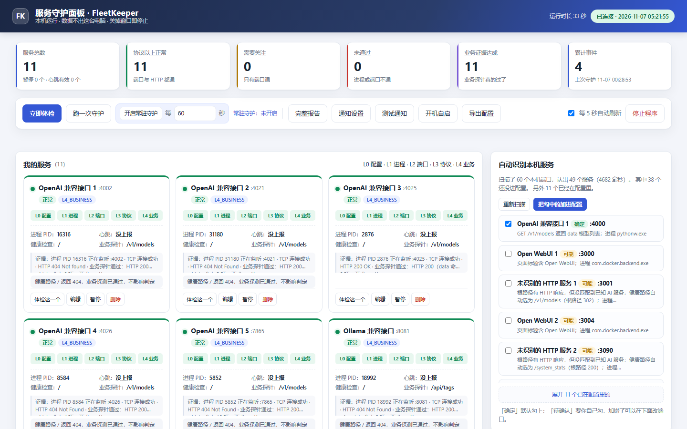
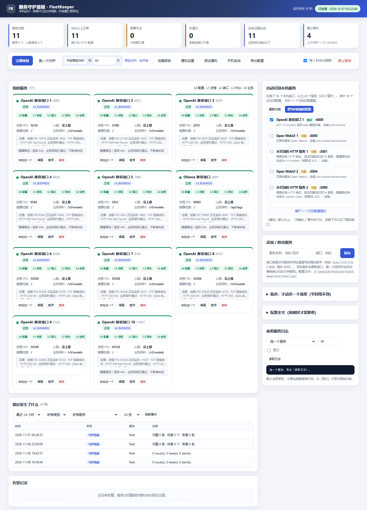

# fleetkeeper

[](https://github.com/muguangyeshang/fleetkeeper/actions/workflows/ci.yml)


**A self-healing watchdog for local AI services, with the safety switches the
usual ones don't have.** WAN down ⇒ record and *never* heal; per-port cooldowns
instead of a global one; pause markers so an operator's "intentionally offline"
is not an incident; PID-validated process ops instead of kill-by-name; and no
auto-claim that a service works just because its port answers.

Pure standard library, zero dependencies. Windows-first, Linux supported.
One sweep is one cron entry.

```bash
fleetkeeper --config fleet.json doctor --html status.html   # offline page, open it in a browser
fleetkeeper --config fleet.json history --last 24h          # what healed itself at 4am
fleetkeeper --config fleet.json sweep                       # cron entry: detect, gate, heal, alert
```

> **不想敲命令？** 直接双击 `fleetkeeper.exe`（用 `scripts\build_exe.bat` 生成，
> 或从 release 下载）。它会自己在旁边生成 `fleet.json`、开一个中文网页、
> 自动打开浏览器，下面这些命令全变成按钮：填服务、立即体检、跑一次守护、
> 查时间线、导出报告、停止。不用装 Python、不用开终端、不用联网。
> 页面只监听 `127.0.0.1`，关掉程序窗口即停止。命令行用户敲 `fleetkeeper`
> （不带任何参数）会打开同一个面板。

The CI badge goes live after the repository is pushed to GitHub.

## 30 seconds to value

```text
1. Double-click fleetkeeper.exe        -> a console opens in your browser
2. Wait for the first scan             -> "已自动识别本机服务：扫描到 N 个，加入了 M 个"
3. Edit a service -> tick 挂了自动重启 -> the watchdog restarts it if it dies
```

That is the whole product. `fleetkeeper doctor` in the same folder prints a
text diagnosis (config / autostart / webhook / per-service P0 list) if you
prefer a terminal.

## What it looks like

The panel the exe opens — services it found by itself, each with the
L0–L4 evidence ladder, one-click auto-restart, and the discovery sidebar
that lists every local listener (AI or not) with what it actually probed:



<details>
<summary>Full page (timeline, alerts, logs, config)</summary>



</details>

## Who this is for

**Install it if** you run several long-lived services on one machine (an AI
gateway, a model server, a queue worker, a scraper) and you are the person who
finds out the next morning that one of them quietly stopped working. Windows is
the primary target; Linux works. You want a restart action with brakes, not
another dashboard.

- You can point at two or more local ports that should stay up.
- You want the restart to be gated: no healing during a WAN outage, per-port
  cooldowns, a pause marker for intentional downtime, PID-validated process
  ops, and no auto-claim that a service works just because its port answers.
- You prefer a single exe or pure-standard-library Python over a database, a
  container stack and a Node runtime.

**Not for you if**

- You monitor many hosts, need a public status page, historical graphs or
  dozens of notification channels. Use [Gatus](https://github.com/TwiN/gatus)
  or [Uptime Kuma](https://github.com/louislam/uptime-kuma).
- `systemd`, `supervisor` or NSSM already restarts your one process and you
  only care about process liveness.
- Your machine has no long-running local services. The first screen would have
  nothing to watch.

This is a narrow tool for a narrow group. It does not try to replace a
monitoring platform; a sensible deployment lets Gatus detect and notify while
fleetkeeper owns the gated restart. If you already run a Gatus instance and
want the "act on it" half, you are exactly the intended reader.

## What doctor prints

A real two-service run: one live local HTTP endpoint with a business canary,
one port with no listener. This is copied from a terminal, not drafted.

```console
$ fleetkeeper --config fleet.json doctor
fleetkeeper doctor  2026-11-06T18:13:31+0800
====================================================================
[??] LLM Gateway            :59201  L4_BUSINESS
      heartbeat: NO_HEARTBEAT  service has no heartbeat; it cannot prove it is working
[P0] Dead Worker            :59202  L0_CONFIG
      heartbeat: NO_HEARTBEAT  service has no heartbeat; it cannot prove it is working
====================================================================
P0 failures (broken for real):
  - Dead Worker :59202
      no process listening

Insufficiently covered (not failures, but work is unproven):
  - LLM Gateway : heartbeat=NO_HEARTBEAT
  a live port proves the process is not dead; it does not prove work.
```

`[??]` beside `L4_BUSINESS` is the whole point. A live port and a passing
canary do not prove the service completed a unit of work, so the doctor
refuses to call it covered.

Open [docs/assets/status-page.html](docs/assets/status-page.html) to see the
offline status page before installing anything. One self-contained HTML file,
generated from a real `status --json` result. No CDN, no JavaScript, no
external references.

## The dashboard

`fleetkeeper start` (or the exe) opens a single self-contained Chinese page on
`127.0.0.1`. It is a working console, not a status widget:

| Area | What it does |
|---|---|
| KPI strip | total / protocol-healthy / needs-attention / down / business-evidence / cumulative events, plus paused and fresh-heartbeat counts |
| Toolbar | one-shot check, one-shot sweep, **resident watchdog** with a configurable 5-3600 s interval, full report, notification test, config export, auto-refresh toggle, stop |
| Service cards | L0-L4 ladder rendered as five steps, PID, heartbeat status and age, health path, canary path, issues, evidence; per-card re-check, heartbeat injection, edit, pause, delete |
| Timeline | filter by window (24h / 7d / 30d / all), event kind, service and row count |
| Alerts | last lines of the alert log, redacted |
| Sidebar | automatic discovery results, quick add, scenario picker, redacted full config, per-service log tail with optional raw mode |

Evidence for all services is collected in a bounded thread pool, so the wall
time is one probe, not one probe per service. A skeleton fills the card grid
during the first read; discovery and `/api/state` start in parallel. The
cheap `GET /api/config` decides whether discovery is allowed to write, so the
page never waits on a slow business canary to become useful.

Every write route is explicit and validated. The browser can edit a name,
port, health path, canary path, heartbeat period and log filename; it cannot
set a recovery command, an alert webhook or an absolute/external URL. Pausing
moves a service into `registry.paused`, which the watchdog already ignores.

## Contents

- [Who this is for](#who-this-is-for)
- [Install](#install)
- [What it looks like](#what-it-looks-like)
- [The dashboard](#the-dashboard)
- [Documentation](#documentation)
- [Project layout](#project-layout)
- [Why this exists](#why-this-exists)
- [The evidence ladder](#the-evidence-ladder)
- [Quick start](#quick-start)
- [Automatic discovery](#automatic-discovery)
- [Alerts, history and the status page](#alerts-history-and-the-status-page)
- [Config](#config)
- [Platform notes](#platform-notes)
- [CLI](#cli)
- [What it deliberately does not do](#what-it-deliberately-does-not-do)
- [How this compares](#how-this-compares)
- [Tested](#tested)
- [FAQ](#faq)
- [Roadmap](#roadmap)
- [Changelog](#changelog)
- [Contributing](#contributing)
- [Releasing](#releasing)
- [Security](#security)
- [License](#license)

## Install

Not published on PyPI yet. Three ways:

**A) Windows, no Python at all — just double-click.** Build the single-file
exe once (needs Python + `pyinstaller` only on the *building* machine):

```bat
scripts\build_exe.bat
```

`dist\fleetkeeper.exe` is ~8 MB, self-contained, and runs on a machine with
no Python installed. Put it in any folder and double-click it; a browser page
opens, `fleet.json` is created next to the exe, and the page's buttons replace
every command below. `start.bat` is the same console for machines that already
have Python. The exe is built locally, not committed to the repository.

**B/C) Command line, both from a checkout:**

```bash
# B) editable install — gives you the `fleetkeeper` console command
python -m pip install -e .
fleetkeeper --help

# C) install nothing — copy src/fleetkeeper anywhere, or point PYTHONPATH at it
PYTHONPATH=src python -m fleetkeeper.cli --config config/fleet.json doctor
```

The Quick start below assumes the editable install. With the PYTHONPATH
route, prefix each command with `PYTHONPATH=src` (Windows: `set PYTHONPATH=src`
first). With the exe, none of it is needed.

Tagging a `v*` release builds the sdist/wheel, opens a **draft** GitHub release
and publishes to PyPI via Trusted Publishing (`.github/workflows/publish.yml`).
The first publish requires registering a pending publisher on PyPI — see
[RELEASING.md](RELEASING.md).

---

## Documentation

| Document | Language | For |
|---|---|---|
| [docs/说明书.md](docs/说明书.md) | 中文 | Double-click-the-exe walkthrough. Every button, every config field, what each status label means, and what to do when something looks wrong. |
| [docs/USER_GUIDE.md](docs/USER_GUIDE.md) | English | Complete CLI and configuration reference, canary expressions, alert receivers, scheduling, troubleshooting. |
| [docs/ARCHITECTURE.md](docs/ARCHITECTURE.md) | English | Module map, sweep data flow, safety gates, state machine, performance limits, test strategy, extension points. |
| [docs/README.md](docs/README.md) | English | Documentation index and conventions. |

## Project layout

```
fleetkeeper/
  README.md                  GitHub home page (this file)
  CHANGELOG.md               Unreleased always at the top
  CONTRIBUTING.md            no runtime deps, a test per behaviour
  SECURITY.md                private advisory, supported versions
  RELEASING.md               version bump, tag, Trusted Publishing
  LICENSE                    MIT
  pyproject.toml             package metadata, dev extra
  MANIFEST.in                sdist contents
  config/fleet.example.json  filled-out config
  config/ollama-stack.example.json  the built-in local-ai preset, checked in
  src/fleetkeeper/           16 standard-library modules
                             (discover.py, manage.py, page.py, ui.py, ...)
  scripts/                   exe entry point, build_exe.bat, acceptance harnesses
  tests/                     175 pytest tests in 15 files
  docs/                      user guide, Chinese manual, architecture, sample page
  start.bat                  console launcher for machines with Python
  .github/workflows/         ci.yml (3 OS x 3.8-3.13), publish.yml, templates
```

---

## Why this exists

A local AI stack — LLM gateways, Ollama, llama.cpp servers, ComfyUI, job
runners, scrapers — fails in ways generic tools (supervisor, NSSM, systemd,
uptime pingers) do not cover:

1. **A port is alive but the service is a zombie.** The process holds the
   listener; every TCP connect times out. "Port up" dashboards stay green
   while every request dies.
2. **A process is running but stopped working.** The main loop is wedged;
   the heartbeat writer hasn't produced a successful unit of work in hours.
   Process monitors see nothing wrong.
3. **A self-heal loop fights a network outage.** The WAN is down, so every
   health check fails, so the healer spawns the whole fleet every cycle —
   a dozen zombies and a CPU spike, then the same again when the cooldown
   expires. Against an outage, healing is noise amplification.
4. **Several agents share one config file.** Read-modify-write races
   silently drop edits; nobody knows who overwrote whom.
5. **Killing the wrong process.** Ten services run under the same
   `pythonw.exe`. Killing by image name is indiscriminate slaughter.

fleetkeeper implements one counter-measure per failure mode, each a
testable rule rather than a promise:

| Mechanism | Module | The rule it enforces |
|---|---|---|
| Evidence ladder L0→L4 | `evidence.py` | a listening port is **not** a working service |
| Deadman-switch heartbeats | `heartbeat.py` | liveness is judged by "how old is the last success", never "does the process exist" |
| Port watchdog with per-port cooldowns | `watchdog.py` | one dead port must not delay the others; cooldown must survive green sweeps |
| Network gate | `watchdog.py` | WAN down ⇒ record, **never** heal |
| Pause gates (marker files) | `watchdog.py` | a human's "intentionally offline" is not an incident |
| Alert storm suppression | `watchdog.py` | first alert at threshold N, re-alert at fixed intervals, one alert on recovery |
| Atomic writes + edit leases | `safeio.py` | concurrent writers coordinate or fail loudly; a lease keeps its baseline hash across renewal |
| PID-only process ops | `proc.py` | no kill-by-name API exists; PID ops validate the command line first |
| Secret redaction | `redact.py` | logs, outbound alerts and config writes are scanned; hits are counted, never echoed |
| Outbound alert fan-out | `notify.py` | webhook + command + file; a broken channel never breaks a sweep; payloads are JSON on stdin, not shell arguments |
| Append-only timeline | `history.py` | `state.json` is a snapshot; sqlite keeps every sweep and alert so an incident can be reconstructed |
| Offline status page | `report.py` | one self-contained HTML file, no CDN/JS/fonts, escapes all config-derived text |

## The evidence ladder

```
L0  config exists   the service is declared in the registry
L1  process exists  a listening process was found and is alive
L2  port healthy    exactly one LISTENING process AND a TCP connect succeeds
L3  protocol        an HTTP status line came back (5xx = alive but sick)
L4  business        a canary through the real business path passes
```

`fleetkeeper doctor` never claims more than it proved. A service whose port
answers but which has no heartbeat shows as `NO_HEARTBEAT` — listed as
"insufficiently covered", not healthy, not broken. Evidence stops at L4;
L5 (a human actually got what they wanted) is never auto-claimed.

A canary hitting the same endpoint as the health check is automatically
downgraded to `protocol_only`: it cannot prove business success, and
fleetkeeper refuses to pretend otherwise.

## Quick start

```bash
# 0. easiest: double-click the exe, or just type `fleetkeeper` (no arguments).
#    It creates fleet.json, opens the browser console, scans the local AI
#    services that are already running and writes them into the config.
#    The dashboard also has a resident watchdog button -- no shell needed.

# 0b. let it find the services that are already running on this machine
fleetkeeper discover                 # report only, writes nothing
fleetkeeper discover --apply         # append the confident ones to fleet.json
fleetkeeper discover --json --apply  # one machine-readable object on stdout

# 1. see the built-in starting scenarios
fleetkeeper init --list-presets

# 2. command-line equivalent (no checkout needed -- `init` works from a wheel)
fleetkeeper init --config fleet.json --preset local-ai

# 3. see the whole fleet with evidence levels (text, JSON, or an offline HTML page)
fleetkeeper --config fleet.json doctor
fleetkeeper --config fleet.json doctor --html status.html

# 4. run one watchdog sweep (this is your cron entry)
fleetkeeper --config fleet.json sweep

# 5. look back at what happened
fleetkeeper --config fleet.json history --last 24h

# or run sweeps in a loop
fleetkeeper --config fleet.json watch --interval 60
```

`init --list-presets` prints three scenarios. `local-ai` writes Ollama on its
published default port plus a gateway and a queue worker, with a real
`/api/tags` business canary. `single` writes one HTTP service, and `empty`
(the default) writes one placeholder on `--port`. The same `local-ai` file is
checked in at `config/ollama-stack.example.json` for reading. Edit
`registry.services` to match your real ports. `net_probe_targets` is empty in
every template, which means the network gate is **off** — add probe hosts to
enable it. Re-running `init` refuses to overwrite unless `--force` is given.
In the browser console, applying a scenario when you already saved services
asks for confirmation, and the API refuses to overwrite without `force`.

`--config` works either before or after the subcommand:
`fleetkeeper --config fleet.json doctor` and
`fleetkeeper doctor --config fleet.json` are equivalent.

## Automatic discovery

Typing a name and a port was the last manual step on the first run. It is gone.

On the first page load with an untouched config, the console scans the
machine's own listening TCP ports, fingerprints each one over loopback HTTP,
and writes the confident matches into `fleet.json` before anything is clicked.
The same engine is `fleetkeeper discover`.

| Recognised | Fingerprint | Business canary written |
| --- | --- | --- |
| Ollama / Ollama-compatible proxy | `GET /api/tags` returns a `models` list, or root body `Ollama is running` | `/api/tags`, `json_path=models`, `min_items=1` |
| OpenAI-compatible (LM Studio, vLLM, LocalAI, gateways) | `GET /v1/models` returns a `data` list | `/v1/models`, `json_path=data`, `min_items=1` |
| ComfyUI | `GET /system_stats` returns `system` | `/system_stats`, `json_path=system`, `min_items=1` |
| Open WebUI / Gradio | root HTML markers | none (liveness only) |
| anything else answering HTTP | a status line | none |

`high` confidence rows are auto-added on a first-run config; `medium` and
`low` rows are listed with a checkbox instead. Health and canary paths always
differ, otherwise `canary_is_protocol_only` would withhold L4. Existing
services are never overwritten: a port already in the registry is skipped, and
the untouched `Example Service` placeholder is dropped only when at least one
real service was added.

Scope: `127.0.0.1` only, GET only, read-only paths only, capped response
bodies, one bulk process-table read, 60 ports / 16 workers / 0.6 s per probe.
A desktop with 48 HTTP listeners scans in about 2 seconds. Nothing is sent
off-host, response bodies never reach the browser, and the image names of
unrecognised local programs are not displayed. The browser sends candidate
**ids**; the server resolves them against its own scan cache, so no health
path, canary URL or command can be injected through the API.

```bash
fleetkeeper discover --ports 11434,8080,8000
fleetkeeper discover --max-ports 20 --timeout 0.3
fleetkeeper init --config fleet.json --discover --force
```

### Wiring a service into heartbeats (one line)

```python
from fleetkeeper.heartbeat import HeartbeatWriter

hb = HeartbeatWriter("my-gateway", period=60).start()
# ...in your request handler:
hb.tick()          # one unit of work completed
# ...on failure:
hb.fail(exc)       # refreshes observed_at, NOT last_success_at
```

The doctor then distinguishes: UP (fresh business heartbeat) /
FAILING (last attempt failed) / STALE (heartbeat too old) /
ALIVE_ONLY / PROTOCOL_ONLY (weak proofs, never masquerade as UP).

### Scheduling (Windows Task Scheduler, every minute)

```
Program : python.exe
Args    : -m fleetkeeper.cli --config C:\path\config\fleet.json sweep
```

On Linux/macOS: `* * * * * cd /path && python -m fleetkeeper.cli --config config/fleet.json sweep`

## Alerts, history and the status page

Three things were missing from a plain port watchdog: getting told, seeing the
fleet at a glance, and answering "what happened overnight". All three are
standard-library only and default to **off** (an existing config behaves
exactly as before).

**Get told.** Add to the `watchdog` block:

```jsonc
"alert_log": "runtime/alerts.log",          // file channel (always on)
"alert_command": null,                       // legacy alias for a command
"history_file": "runtime/history.sqlite3",
"notify": {
  "channels": ["webhook", "command"],
  "webhook_url": "http://127.0.0.1:9100/hook",
  "webhook_timeout": 3.0,
  "command": ["python", "hook_command.py"],   // list or string; receives JSON on stdin
  "command_timeout": 10.0
}
```

A minimal receiver to verify the webhook end to end:

```python
# hook_receiver.py  ->  python hook_receiver.py
from http.server import BaseHTTPRequestHandler, HTTPServer
import json

class H(BaseHTTPRequestHandler):
    def do_POST(self):
        body = self.rfile.read(int(self.headers.get("Content-Length") or 0))
        print(json.loads(body))          # {title, level, message, issues, healed, ts, ...}
        self.send_response(200); self.end_headers()
    def log_message(self, *a): pass

HTTPServer(("127.0.0.1", 9100), H).serve_forever()
```

```python
# hook_command.py  (receives the same JSON on stdin, not on the command line)
import sys, json
print(json.load(sys.stdin))
```

`sweep` prints `notify[abnormal(x2)]: webhook=ok HTTP 200` — that line is the
success criterion. Fields named `api_key` / `token` / `password` / `secret`
and any key-like text in a message are replaced with `[REDACTED]` before the
payload leaves the host; webhook URLs are stripped out of error messages. A
dead channel yields `error ...` and the sweep still heals normally.

**See the fleet.** `status --html status.html` / `doctor --html status.html`
write one self-contained file: inline CSS, dark/light via
`prefers-color-scheme`, responsive cards, a five-rung evidence bar per service,
and P0 / coverage-gap badges. No CDN, no JS, no external fonts, no network
calls — it opens by double-clicking on an offline host. `--html` with no path
prints the document to stdout for piping. Config-derived names are HTML-escaped.

**Answer "what happened at 4am".** Every sweep and every alert is appended to
`runtime/history.sqlite3`. Retention defaults to 30 days; set
`history_retention_days` in the `watchdog` block to change it (`0` keeps
everything). `state.json` remains a snapshot; the timeline never overwrites.

```bash
fleetkeeper --config fleet.json history --last 24h
fleetkeeper --config fleet.json history --last 7d --kind alert --json
fleetkeeper --config fleet.json history --last all --service "LLM Gateway"
```

Accepted windows: `90s`, `30m`, `24h`, `7d`, `all`; a bare number means hours.
Timestamps carry milliseconds so several sweeps in the same second stay
ordered. Each row names the affected service(s) — resolved from the port in
the issue line back to `registry.services` — so `--service` really filters
(and a multi-service incident still matches any one of its members). The same
service/port pair is included in webhook and command payloads.

## Config

```jsonc
{
  "registry": {
    "defaults": { "heartbeat_period": 60 },   // inherited by every service
    "services": {
      "gateway": {
        "name": "LLM Gateway", "port": 8080,
        "health": { "path": "/", "method": "GET", "timeout": 5 },
        "canary": {
          "type": "http", "path": "/v1/models",
          "expect": { "status": 200, "json_path": "data", "min_items": 1 }
        },
        "recovery": "watchdogs/gateway_watchdog.py"   // what to launch when dead
      }
    }
  },
  "watchdog": {
    "threshold": 2,                  // consecutive bad sweeps before first alert
    "re_alert_interval": 15,         // re-alert cadence (sweeps)
    "heal_cooldown_seconds": 180,    // PER PORT
    "net_probe_targets": [["1.1.1.1", 443]],
    "pause_gates": { "gateway": { "ports": [8080], "marker_file": "PAUSE_GW" } },
    "alert_log": "runtime/alerts.log",
    "history_file": "runtime/history.sqlite3",
    "history_retention_days": 30,
    "notify": {
      "channels": ["webhook", "command"],
      "webhook_url": null,             // null = channel disabled
      "command": null                  // legacy alias: "alert_command"
    }
  }
}
```

Notes that matter in practice:

- A canary may omit `port` and `host` — they default to the service's port and
  `127.0.0.1`. Omitting them used to pin the ladder at L3; the README example
  is now a regression test.
- Every probe reads at most 64 KiB of body (`MAX_PROBE_BYTES`). A canary with
  `json_path` inspects the **same** response — one request per canary, not two.
- `expect` supports `status`, `min_bytes`, and `json_path` + `min_items`.
- `registry.defaults` is merged into each service; service-level keys win.
  `heartbeat_dir`, `state_file`, `alert_log`, `history_file` and
  `pause_gates.marker_file` resolve relative to the config file, not the
  current working directory.
- `notify` is optional. With no `webhook_url` and no `command`, `sweep` behaves
  exactly like 0.1.1 (file log only). See
  [Alerts, history and the status page](#alerts-history-and-the-status-page).

## Platform notes

| Platform | Listener source | Result |
|---|---|---|
| Windows | `netstat -ano` (`LISTENING` + PID) | full ladder |
| Linux | `netstat -tlnp` (parses `4321/python3`) | full ladder |
| macOS / no `-p` | `netstat -an` (`*.80`, no PID) | L1 reports "PID unavailable"; L2+ still works |
| `psutil` installed | `psutil.net_connections` | preferred on every platform |

When no PID can be recovered, `proc.py` emits the sentinel `-1` and
`evidence.py` records "a listener exists but is unidentified" — it does not
collapse the ladder to L0. If `netstat` is absent entirely, install `psutil`
(optional, never a hard dependency) or the fleet will report L0.

## CLI

```
fleetkeeper                                            open the browser console
fleetkeeper start [--port N] [--no-browser]             same console, explicit
fleetkeeper init [--config FILE] [--preset NAME] [--force]  write a runnable config
fleetkeeper init --list-presets                            show starting scenarios
fleetkeeper init --discover [--discover-timeout S]         init + autodiscovery
fleetkeeper discover [--apply] [--json] [--ports P,P]      find local AI services
fleetkeeper status [SERVICE] [--json | --html [FILE]]   evidence ladder per service
fleetkeeper doctor [--json | --html [FILE]]             fleet-wide diagnosis (P0 vs uncovered)
fleetkeeper heartbeat SERVICE [--fail] [--proof ...]    write one heartbeat manually
fleetkeeper sweep [--json]                              one watchdog sweep (cron entry)
fleetkeeper watch [--interval S]                        sweeps in a loop
fleetkeeper history [--last 24h] [--kind alert] [--json]  incident timeline
fleetkeeper logs SERVICE [--tail N] [--raw]             service logs, redacted by default
```

`--html` with no filename writes the document to stdout. `--json` and
`--html` are mutually exclusive.

## What it deliberately does not do

- **No kill-by-name.** `proc.py` exposes PID-only operations and validates
  the command line against an expected substring before acting.
- **No healing during a network outage.** Recorded, never executed.
- **No "everything is fine" claims.** Uncovered services are listed as
  uncovered, not silently green.
- **No unbounded reads.** Probes cap the response body at 64 KiB.
- **No duplicate canary traffic.** JSON inspection reuses the probe response.

## How this compares

Same category, different job. This table is about what each tool does on a
single host, not about which one is better overall.

| Tool | Detection | Does it act on a dead service? |
|---|---|---|
| **fleetkeeper** | port + PID + TCP + HTTP + business canary + heartbeat age | **Yes**, behind WAN / cooldown / pause / PID gates |
| [Gatus](https://github.com/TwiN/gatus) (Go, 12.5k stars) | 12 protocols, condition DSL, 44 alert providers, Vue status page, maintenance windows, SQL storage, WAN connectivity gate | No. A source-level read of its `watchdog/` found no `exec.Command`, `os.StartProcess`, `Restart` or self-heal code path. |
| [Uptime Kuma](https://github.com/louislam/uptime-kuma) (Node, 93k stars) | full self-hosted monitoring UI, status pages, push/heartbeat checks | No restart action |
| [Healthchecks](https://github.com/healthchecks/healthchecks) (~10.5k stars) | deadman-switch heartbeats only | No |
| supervisor / systemd / NSSM | process liveness | Yes, with no business canary, no WAN gate and no per-port cooldown |

The dividing line is worth stating plainly: Gatus also has a WAN gate
(`Connectivity.Checker`), so that mechanism is not unique here. What it does
not have is a healing action. A sensible deployment lets Gatus do detection
and notification while fleetkeeper owns the gated restart.

## Tested

175 pytest tests, including a fake live fleet over real HTTP sockets, product
fingerprinting against real loopback servers, a real loopback browser console
exercised over HTTP (routing, first-run config, autodiscovery, service
editing, per-service actions, heartbeat, log redaction, resident watch,
sweep, timeline, report, graceful stop), a frozen-exe
double-click smoke run, a real local webhook receiver and a real subprocess
command hook:
cooldown persistence across green sweeps, duplicate-instance handling,
network-down suspension, pause gates, alert storm suppression, clock-skew
poisoning, lease renewal keeping its baseline, redaction of keys/JWTs/
private-key markers (including field-name-based masking in structured
payloads), HTML escaping of config-derived names, timeline retention, and
end-to-end CLI runs.

Ten regression tests (`test_regressions.py`) lock the four review findings:
README-example canary reaching L4, bounded body reads, one request per
canary, `defaults` merging, config paths not leaking between runs, Windows /
Linux / macOS netstat parsing, and unknown-PID tolerance.

```bash
python -m pytest
```

## FAQ

**Why does the page say "Failed to fetch" / cannot reach the local service?**
The console is an HTML tab backed by the running exe. Closing the console
window, pressing "Stop", or leaving an old tab open after a restart leaves
that tab pointing at a port nobody listens on anymore (ports are chosen by
the OS on each launch). The page probes `GET /api/ping` to tell "process
exited" from "state() failed", pauses its 5-second polling after three
consecutive failures, and shows a reconnect button. Restart the exe and open
the new URL printed in its window; close the stale tab.

**How does it know which services I run, and what if it gets one wrong?**
It reads the OS listening-port table, then sends GETs to `127.0.0.1` on
`/`, `/api/tags`, `/v1/models` and `/system_stats`. Only high-confidence
matches are written automatically, and only while the config is still the
untouched first-run placeholder. Everything else is shown in a checkbox list.
A wrong entry is just a registry row: change its port in the console, or run
`fleetkeeper init --force` to start over. Nothing is killed, restarted or
reconfigured during discovery.

**Why does the page show grey skeleton cards for a second on first load?**
`/api/state` probes every configured service (process, TCP, HTTP and canary).
Those probes run in a bounded thread pool, but the slowest service still sets
the wall time. The skeleton appears immediately, discovery starts in parallel,
and the cheap `GET /api/config` answers "may I write?" without probing
anything. On an 11-service desktop the full state read is about 1.9 s.

**Do I still need `fleetkeeper watch` in a terminal?**
No. The toolbar's "开启常驻守护" starts an in-process loop at the interval you
enter (5-3600 s). It calls the same `watchdog.run()` as the CLI and the cron
entry, and reports its run count and last error on the page. The CLI loop
remains available for headless hosts.

**Why does a service with `L4_BUSINESS` still show `??`?**
L4 proves a canary passed. It does not prove the service completed a unit of
work. Without a heartbeat the doctor lists the service as insufficiently
covered, which is a third state, neither healthy nor broken.

**Why did nothing get restarted during an outage?**
That is intentional. When every `net_probe_targets` host is unreachable, the
sweep records the issues and returns without launching anything. Set reachable
targets, or set `net_probe_targets: []` to disable the gate entirely.

**Can it kill a process by name?**
No such API exists. `proc.py` exposes PID-only operations and validates the
command line first. Ten services may share one `pythonw.exe` on Windows.

**Does the exe phone home, or need the internet?**
No. It binds to `127.0.0.1`, has no embedded URLs, and makes no outbound
request unless you configure `notify.webhook_url`. The offline HTML page has
zero external references.

**Is it a daemon? Does it autostart?**
No. One sweep is one short-lived process owned by your cron or Task Scheduler
entry. The browser console lives only while its window is open. Nothing is
written to the registry and no service or scheduled task is installed.

**Where does it write data?**
Under `runtime/` next to the config file. `state.json` is a snapshot,
`history.sqlite3` is an append-only timeline, `alerts.log` is text, and
`heartbeat/` holds one JSON per service. Delete the folder to reset.

**Can I use it with Gatus or Uptime Kuma?**
Yes. Let them own detection and display; point fleetkeeper at the same ports
for the gated healing action. An inbound-webhook adapter on `notify.py` is the
cleanest next step and is on the roadmap.

**Which Python versions and systems?**
Python 3.8+ on the CLI path, Windows-first with Linux supported. macOS and
hardened containers degrade to port-level evidence when `netstat` exposes no
PID, and say so explicitly. The exe is Windows only, Python 3.8-3.13 in CI.

## Roadmap

Cheap additions that do not require a core rewrite, all standard library:

1. Concurrent per-service probes (a sequential sweep is O(n) in network
   timeouts, the current scaling limit).
2. Alert state machine fields: success threshold, send-on-resolved, minimum
   reminder interval.
3. A canary expression DSL beyond the current four `expect` keys.
4. Read-only `/metrics` and badge routes, plus an inbound webhook adapter so
   an external detector can trigger a gated heal.

Explicitly **not** planned: 44 alert providers, a JavaScript SPA, Postgres,
Helm/K8s deployment, 12 probe protocols, or a public status page. Those would
turn this into a smaller version of a project that already exists.

## Changelog

See [CHANGELOG.md](CHANGELOG.md) — `Unreleased` is always at the top.

## Contributing

See [CONTRIBUTING.md](CONTRIBUTING.md). Short version: no third-party runtime
imports, every behaviour change gets a test, no machine-specific values in
config examples.

## Security

See [SECURITY.md](SECURITY.md). Only the latest non-prerelease version is
supported; vulnerabilities go through a private advisory, not a public issue.

## Releasing

See [RELEASING.md](RELEASING.md) for the version bump, tag and verification
commands.

## License

MIT
