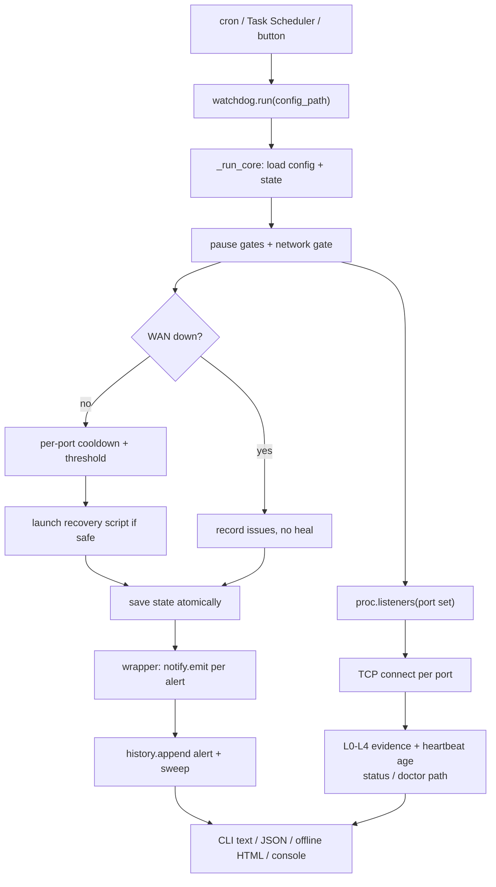

# Architecture

Design document for reviewers and contributors. Usage and every config key
are in [USER_GUIDE.md](USER_GUIDE.md); the button-by-button path is in
[说明书.md](说明书.md).

## 1. Scope and non-goals

fleetkeeper is a **healing controller** for services running on one host. It
answers three questions in one sweep: what can be proven about each service,
whether an action is currently safe, and what happened in previous sweeps.

It is deliberately not a monitoring platform. There is no long-running server
in the CLI path, no multi-host view, no dashboard built on a JavaScript stack,
no metrics exporter, no remote storage. A sweep is a short-lived process that
can be owned by cron or Task Scheduler. The browser console is a local,
optional front end over the same functions.

The single most important design constraint: **a bad outbound integration must
never change a healing decision.** That constraint produced the two-phase
`run()` wrapper described in section 4.

## 2. Module map

13 modules, 2,899 lines, zero runtime imports outside the standard library.
`psutil` is used opportunistically when present and is never required.

| Module | Lines | Responsibility | Public surface |
|---|---:|---|---|
| `cli.py` | 442 | Argument parsing, command dispatch, view assembly | `build_parser()`, `main()`, `cmd_*` |
| `ui.py` | 523 | Local browser console, inline CSS/JS-free page, HTTP routes | `serve()`, `make_server()`, `ConsoleHandler` |
| `watchdog.py` | 379 | Sweep, gates, healing, alert dedup, wrapper | `run()`, `net_gate()`, `load_state()`, `save_state()` |
| `report.py` | 229 | Self-contained offline HTML | `normalize()`, `render()` |
| `proc.py` | 222 | Listener enumeration, PID verification, process ops | `listeners()`, `proc_info()`, `verify_pid()`, `kill_pid()` |
| `evidence.py` | 219 | L0-L4 ladder, bounded HTTP/TCP probes, canary | `evaluate_service()`, `check_canary()` |
| `heartbeat.py` | 217 | Deadman-switch files and writer | `write()`, `read()`, `evaluate()`, `HeartbeatWriter` |
| `history.py` | 196 | SQLite append-only event stream | `append()`, `query()`, `parse_since()`, `sweep_event()` |
| `safeio.py` | 192 | Atomic writes, backups, edit leases | `atomic_write_text()`, `acquire_lease()`, `write_with_lease()` |
| `notify.py` | 160 | Webhook / command / file fan-out, redaction | `emit()`, `build_payload()`, `parse_alert_line()` |
| `template.py` | 58 | Embedded default config for `init` | `default_config()`, `render()` |
| `redact.py` | 51 | Secret pattern scanning and masking | `scan()`, `redact()`, `safe_env()` |
| `__init__.py` | 11 | Version | `__version__` |

Dependency direction is one-way. `evidence` knows nothing about `watchdog`;
`notify` and `history` know nothing about healing; `cli` and `ui` are the only
modules that assemble a view. `safeio` and `redact` are leaves.

## 3. Data flow



Text form, for readers without Mermaid:

```
config JSON ---> load_state() ---> pause gates ---> net_gate()
                                                   |
                              (down) ------------+----> issues only, no heal
                              (up)                |
                                     proc.listeners(ports)  [one netstat call]
                                                   |
                              TCP connect + HTTP probe + canary  [per port]
                                                   |
                              per-port cooldown / duplicate-instance check
                                                   |
                              recovery script (PID-validated, never by name)
                                                   |
                              atomic state write ---> notify ---> history
```

`status` and `doctor` stop at the evidence stage. They never heal, never
write state, and never send an alert. Only `sweep` / `watch` do.

## 4. Two-phase sweep

`watchdog.run()` is a wrapper around `watchdog._run_core()` (`watchdog.py:308`
and `watchdog.py:100`). The core performs detection, gating, healing and alert
deduplication, then returns a summary dict. The wrapper then:

1. Resolves the history DB and retention from the same config.
2. Maps each issue's `(:port)` back to `registry.services` so alerts and
   timeline rows carry a real service name.
3. Calls `notify.emit()` for each alert.
4. Appends the alert events and one `sweep` event to SQLite.

Every step in the wrapper is inside a `try` whose failure is recorded as
`notify_error` on the summary. Before this split, a dead webhook receiver or
a corrupt history DB would have been able to abort a sweep after the healing
decision had already been made. Tests for the core call `run()` and assert
the same summary shape, so the public API did not change.

## 5. Evidence ladder

`evidence.evaluate_service()` (`evidence.py:153`) escalates one rung at a
time and stops at the first failed proof:

| Rung | Proof collected | Failure branch |
|---|---|---|
| L0 | service declared in registry | no port configured |
| L1 | at least one listener with PID | no listener, or >1 listener (duplicate instance) |
| L2 | exactly one listener AND TCP connect succeeds | connect fails while port is held (zombie) |
| L3 | HTTP status line returned | probe error; 5xx is alive but sick, 4xx is a path/auth warning |
| L4 | canary through a different business path passes | canary configured and failed |

Properties worth knowing:

- `MAX_PROBE_BYTES = 65536` (`evidence.py:25`). `http_probe` reads a bounded
  body and returns it, so `json_path` inspection reuses the same response.
  One canary produces exactly one request. This is a regression-tested claim.
- A canary whose host, port and path equal the health check is downgraded by
  `canary_is_protocol_only()` (`evidence.py:142`). It cannot prove business
  success, so the ladder stays at L3.
- Omitting `canary.port` and `canary.host` is safe: `check_canary()` receives
  the service port via `default_port` (`evidence.py:74`).
- When `netstat` exposes no PID, `proc.py` emits `-1` and the ladder records
  an unidentified listener rather than collapsing to L0.
- Heartbeats are a separate axis. `heartbeat.evaluate()` judges the age of
  `last_success_at`, not the existence of a process. `hb.fail()` refreshes
  `observed_at` but deliberately leaves `last_success_at` alone.
- L5 is never claimed. A port, a canary and a heartbeat together still do not
  prove a human got the result they wanted.

`doctor` prints `??` for insufficiently covered services. That is a distinct
state from healthy and from broken, and `report.py` badges it separately.

## 6. Safety gates and state

State lives in one JSON file written through `safeio.atomic_write_text()`.

| Mechanism | Implementation | Why |
|---|---|---|
| WAN gate | `net_gate()` `watchdog.py:66`, called at `:158` | Against an outage, healing is noise amplification. Record, never launch. |
| Explicit off for the gate | `raw_targets is None` check at `watchdog.py:137` | An explicit `[]` means disabled. Only a missing key gets a default target. `or` here used to silently re-enable public-IP probes on a fresh install. |
| Pause gates | `watchdog.py:143-156` | An operator's "intentionally offline" is not an incident. |
| Per-port cooldown | `watchdog.py:207-232` | A global cooldown delays unrelated failures. `heal_history` survives green sweeps. |
| Clock-skew guard | `watchdog.py:218-224` | A future timestamp would make elapsed time negative forever and bypass the cooldown. Detected and normalized. |
| Threshold + re-alert | `watchdog.py:254`, `:272-273` | First alert at N consecutive bad sweeps, then every `re_alert_interval` sweeps, one recovery alert. |
| Duplicate instance | `watchdog.py:202` | Two processes on one port is an incident, never a heal trigger. |
| PID-only ops | `proc.verify_pid()` `:174`, `kill_pid()` `:195` | Ten services may share one `pythonw.exe`; there is no kill-by-name API. |
| Atomic + lease | `safeio.py:63`, `:129`, `:176` | Read-modify-write races drop edits. A lease keeps its baseline sha256 across renewal, so drift raises instead of overwriting. |
| Redaction | `redact.py`, `notify._clean()` `notify.py:51` | Field names (`api_key`, `token`, `password`, `secret`) and key-like text are masked before a payload crosses a process or network boundary. URLs are stripped from errors. |

`state.json` is a snapshot. `history.sqlite3` is the append-only record. The
two never derive from each other, so a wiped state file cannot erase an
incident timeline.

## 7. Concurrency and performance

A sweep is sequential across services: **O(n)** in the number of services,
with one `netstat` call batched for the whole port set rather than one per
port. Per-service cost is dominated by network timeouts, so the worst case
is roughly `n * (tcp_timeout + http_timeout + canary_timeout)` on a host
where every service is down. With defaults that is bounded, but a fleet of
hundreds of dead ports will make one sweep slow. Concurrent probing is on
the roadmap and is the main known scaling limit.

Other bounds:

- HTTP response bodies are capped at 64 KiB; a canary cannot make the process
  read an unbounded stream.
- `notify` timeouts are separate (`webhook_timeout`, `command_timeout`) and a
  hung channel cannot hang the sweep forever.
- SQLite writes are two inserts per sweep plus one per alert, with a
  retention prune on append.
- `ui.py` caps request bodies at 64 KiB and binds only to `127.0.0.1`.
- The browser console polls `/api/state` every 5 seconds; it does not hold a
  long-lived connection.
- There is no cross-process lock on sweeps. Two overlapping crons can both
  read the same state file. `safeio` makes each write atomic, but last-writer
  wins on the snapshot. Scheduling one sweep per minute with a runtime well
  under a minute is the intended deployment.

## 8. Zero-dependency policy

No third-party import is allowed in `src/` at runtime. `psutil` is imported
inside a guarded branch in `proc.py` and only used when available. `pytest`,
`build`, `twine`, `pyinstaller` and `pre-commit` are development extras in
`pyproject.toml`. The consequence is that the wheel works offline on an
air-gapped host and the exe contains no vendor libraries.

`ui.py` serves one HTML string with inline CSS and a small inline script for
button actions. It has no CDN, external font, or third-party JS. The offline
`report.py` page has no JavaScript at all.

## 9. Test strategy

99 tests in 11 files. Real loopback sockets and real subprocesses are used
where a fake would hide the bug; pure logic uses monkeypatched fixtures.

| File | Tests | What it locks |
|---|---:|---|
| `test_cli.py` | 14 | Command routing, `--config` on either side of the subcommand, init, html, history, logs |
| `test_ui.py` | 11 | Real loopback console: routing, first-run config, service editing, sweep, timeline, report, stop |
| `test_watchdog.py` | 10 | Cooldown persistence, network-down suspension, pause gates, alert storms, clock skew, explicit empty gate with a simulated outage |
| `test_regressions.py` | 10 | README-example canary reaching L4, bounded reads, one request per canary, defaults merging, config path isolation, three netstat dialects, unknown-PID tolerance |
| `test_safeio.py` | 9 | Atomic replace, backups, lease conflicts, baseline hash across renewal |
| `test_history.py` | 9 | Window parsing, retention, service filtering including multi-service incidents |
| `test_notify.py` | 9 | Real local webhook receiver, real subprocess command hook, redaction, channel isolation |
| `test_heartbeat.py` | 8 | Stale / failing / weak-proof classification |
| `test_report.py` | 7 | XSS escaping, five-rung ladder, P0 badges after JSON round-trip |
| `test_evidence.py` | 6 | Rung escalation and canary downgrade |
| `test_redact.py` | 6 | Keys, JWTs, private-key markers |

The wheel install and the frozen exe are exercised separately in first-run
smoke runs from a clean directory with Python removed from `PATH`.

```bash
python -m pytest -q              # 99 passed
python -m compileall -q src tests
python -m build
python -m twine check dist/*
scripts\build_exe.bat            # Windows, optional
```

## 10. Known limits and explicit non-goals

From the source-level comparison with `TwiN/gatus` (12.5k stars, Go single
binary): Gatus has 12 probe protocols, 44 alert providers, a Vue status page,
optional SQL storage, Helm/Docker deployment and a mature alert state machine
with failure/success thresholds, reminder intervals and maintenance windows.
It also has `Connectivity.Checker`, a WAN gate, so that mechanism is not unique
to this project.

What Gatus has **no code path for** is launching or restarting a process:
`exec.Command`, `os.StartProcess`, `Restart` and self-heal patterns produce no
hits in its `watchdog/`. fleetkeeper's differentiation is the healing action
plus the safety boundary around it, plus edit leases, redaction and zero
dependencies.

Deliberately not planned, because they would turn this into a smaller version
of a project that already exists: 44 alert providers, a JavaScript SPA,
Postgres, Helm/K8s deployment, 12 probe protocols, a public status page.

Cheap and worth adding later, all standard library, none requiring a core
rewrite: concurrent probes, the three alert-state-machine fields, a canary
expression DSL, and read-only `/metrics` plus badge routes.

A natural integration is the reverse of the current `notify.py`: accept an
inbound webhook from Gatus so a 12.5k-star ecosystem does detection while
fleetkeeper owns the gated healing action.

## 11. Extension points

- **New probe type** `check_canary()` in `evidence.py`. Unsupported types are
  reported, not guessed.
- **New alert channel** `emit()` in `notify.py`. Keep it inside the wrapper so
  failures stay isolated from healing.
- **New view** `cli.cmd_*` or a `ui.py` route. Both consume the same
  `evidence` / `history` functions; neither owns state.
- **New gate** `_run_core()` before the heal block at `watchdog.py:207`.
  Gates must be able to stop healing without suppressing the issue record.

## 12. Reproducing the claims

```bash
# module and test counts
wc -l src/fleetkeeper/*.py
grep -h '^def test_' tests/test_*.py | wc -l

# bounded reads and one request per canary
grep -n "MAX_PROBE_BYTES" src/fleetkeeper/evidence.py

# explicit empty target list really disables the gate
python -m pytest tests/test_watchdog.py::test_empty_net_probe_targets_disables_the_gate -q

# offline page has no external references
grep -c "https\?://\|<script\|cdn" docs/assets/status-page.html
```
